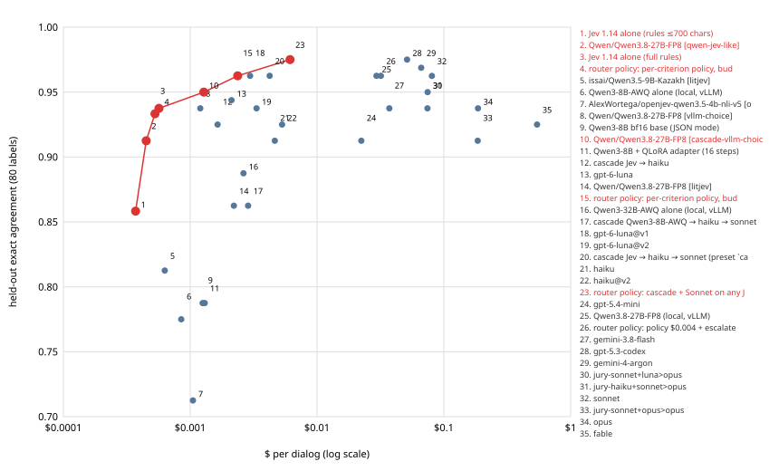

# EXPERIMENTS — CQA scoring of Freedom Broker support dialogs

_Generated by `python scripts/build_experiments.py` from the raw files in `results/` and the labels in `examples/gold*/`. Do not edit by hand; re-run the script when new runs land. Bootstrap: 10,000 resamples of dialogs, seed 20261108._

## 1. Executive summary

All accuracies are exact agreement with **our own synthetic labels** on the 10-dialog held-out set (80 labels, 1 label = 1.25 pp). Brackets = 95 % bootstrap CI over dialogs. With n = 10 almost no pairwise difference among the top configurations is statistically significant.

1. **Cascade ≈ jury at a fraction of the cost.** Jev→haiku→sonnet: 0.963 [0.912, 1.000] at $0.00423/dialog vs the Claude jury 0.950 [0.875, 1.000] at $0.0745/dialog (≈18× cheaper on held-out; ≈5–17× incl. DEV, docs/OSS_ROUTER.md); on 65 real DEV dialogs it agrees with the v7 jury on 0.948 of labels. Paired Δ = +0.013 [-0.025, +0.050], **not significant**.
2. **Best single cloud model:** gpt-5.3-codex 0.975 [0.938, 1.000] (runs 0.975, 0.975), MAE 1.54, $0.0512/dialog. Vs jury: Δ = +0.025, **not significant**.
3. **A local open-weight model reaches the jury band with no cloud call.** Qwen3.8-27B-FP8 on 1× H100 SXM: 0.963 [0.925, 1.000], MAE 4.30, 26.56 s/dialog, ≈$0.0294/dialog GPU time. Vs jury Δ = +0.013 (**not significant**); vs Jev Δ = +0.029 (**not significant**). Single run.
4. **Kazakh-specialised ≠ better here.** ISSAI 9B Kazakh 0.887 [0.825, 0.950] vs general Qwen3.8-27B 0.963 [0.925, 1.000] (Δ = -0.075, significant (p<0.05)); the KZ subset is only 2 dialogs (ISSAI 0.938 vs 1.000), and the models also differ in size (9B vs 27B).
5. **Fine-tune after 0.32 epoch: MAE ↓, agreement =.** QLoRA Qwen3-8B 0.787 vs base 0.787 (Δ = +0.000, **not significant**); total MAE 12.17 → 10.43. Still far below Jev 1.14 (0.933).
6. **Kazakh parser signals: no measurable gain.** Hybrid 0.950 vs cascade 0.950 on held-out (Δ = +0.000, **not significant**); KZ subset 1.000 vs 1.000.
7. **Noise floor:** repeated held-out runs of the same configuration differ by 0–2 labels (0–2.5 pp, §3.2), the same size as most claimed differences.

## 2. Evaluation protocol

| set | dialogs | labels | languages | labelled by | used for |
|---|---|---|---|---|---|
| tuned gold `examples/gold/` | 16 | 128 | RU 9, KZ 3, EN 4 | us (rule authors), **synthetic** | prompt/rule development, threshold tuning, prompt-variant selection |
| held-out `examples/gold_holdout/` | 10 | 80 | RU 5, KZ 2, EN 3 | us, **synthetic**, written after tuning | reporting only; model selection (so no longer pristine) |
| DEV `results/dev_jury_v7.json` | 65 | 520 | real RU/KZ/EN chats + calls | **no human labels** | agreement with our own jury (consistency, not accuracy) |

Rules:
- Prompts, rubric text, router thresholds and prompt variants are tuned **only on the tuned gold**; held-out is run once per configuration, decisions taken before looking (docs/MODELS.md protocol).
- Leakage controls: `tests/test_models_bench.py` checks few-shot variants for verbatim held-out lines; the fine-tune dataset builder refuses `examples/gold_holdout` and splits by conversation (`leakage_conversations = []`); the tuned gold **is** in the fine-tune train set, so gold numbers for the adapter only measure fit.
- Known contamination: one general 04/03 rule was added after a held-out mismatch (hold-02), the Jev rule-truncation choice was made after seeing both sets, and held-out was used to rank models (docs/HISTORY.md, docs/JEV.md, docs/MODELS.md).

| metric | definition |
|---|---|
| per-criterion agreement | exact match of value (YES/NO/NA or scale step) per criterion |
| overall agreement | matched labels / all labels (8 × dialogs); runs averaged when repeated |
| total MAE | mean |predicted 0–100 total − expected_total| per dialog (scoring in code) |
| gross P / R | precision / recall of the criterion-08 gross-error flag (held-out has 1 positive) |
| NA confusion | expected NA predicted applicable, and vice versa |
| $/dialog | provider-reported tokens × `cqa/pricing.py`; local = GPU $/h × wall ÷ dialogs |
| s/dialog | wall-clock ÷ dialogs at the run's concurrency (8–16), not single-call latency |

## 3. Statistics

### 3.1 Paired comparisons (held-out, per-dialog)

Δ = mean per-dialog agreement A − B (runs averaged per dialog), 95 % paired-bootstrap CI and two-sided bootstrap p; McNemar exact test on the 80 labels of the first run of each (b = A right/B wrong, c = reverse; treats labels as independent, which is optimistic).

| A | B | purpose | dialogs | Δ agreement [95 % CI] | p (boot) | b / c | p (McNemar) | verdict |
|---|---|---|---|---|---|---|---|---|
| cascade Jev→haiku→sonnet | jury haiku+sonnet→opus (2 runs) | main cost claim | 10 | +0.013 [-0.025, +0.050] | 0.756 | 3 / 2 | 1.000 | **not significant** |
| gpt-5.3-codex (2 runs) | jury haiku+sonnet→opus (2 runs) | best single model vs jury | 10 | +0.025 [-0.025, +0.087] | 0.545 | 3 / 1 | 0.625 | **not significant** |
| Qwen3.8-27B-FP8 local | Jev 1.14 (3 runs) | local vs decision model | 10 | +0.029 [+0.000, +0.062] | 0.051 | 4 / 2 | 0.688 | **not significant** |
| Qwen3.8-27B-FP8 local | jury haiku+sonnet→opus (2 runs) | local vs jury | 10 | +0.013 [-0.037, +0.075] | 0.893 | 3 / 2 | 1.000 | **not significant** |
| ISSAI 9B Kazakh | Qwen3.8-27B-FP8 | KZ-specialised vs general | 10 | -0.075 [-0.113, -0.037] | 0.000 | 0 / 6 | 0.031 | significant (p<0.05) |
| QLoRA adapter | Qwen3-8B base | fine-tune effect | 10 | +0.000 [-0.100, +0.100] | 1.000 | 6 / 6 | 1.000 | **not significant** |
| hybrid (KZ signals ON) | cascade (signals OFF) | parser signals effect | 10 | +0.000 [+0.000, +0.000] | 1.000 | 0 / 0 | 1.000 | **not significant** |
| Jev 1.14 (3 runs) | jury haiku+sonnet→opus (2 runs) | decision model vs jury | 10 | -0.017 [-0.067, +0.050] | 0.550 | 3 / 4 | 1.000 | **not significant** |
| jury v7 code | jury v6 code | v7 bundle | 10 | +0.013 [-0.025, +0.050] | 0.776 | 2 / 1 | 1.000 | **not significant** |
| cascade Qwen3-8B tier 1 | cascade Jev tier 1 | tier-1 choice | 10 | -0.100 [-0.175, -0.025] | 0.003 | 0 / 8 | 0.008 | significant (p<0.05) |
| Jev full rules (3 runs) | Jev rules ≤700 (3 runs) | rule truncation | 10 | +0.075 [+0.025, +0.129] | 0.001 | 8 / 1 | 0.039 | significant (p<0.05) |

### 3.2 Run-to-run variance (same configuration, repeated held-out runs)

| configuration | runs | per-run agreement | range (labels of 80) |
|---|---|---|---|
| gpt-5.3-codex | 2 | 0.975 / 0.975 | 0 |
| gemini-4-argon | 2 | 0.975 / 0.963 | 1 |
| sonnet | 2 | 0.950 / 0.975 | 2 |
| jury-haiku+sonnet>opus | 2 | 0.950 / 0.950 | 0 |
| gpt-6-luna | 2 | 0.950 / 0.938 | 1 |
| Jev 1.14 alone (full rules) | 3 | 0.938 / 0.925 / 0.938 | 1 |
| Jev 1.14 alone (rules ≤700 chars) | 3 | 0.850 / 0.838 / 0.887 | 4 |
| jury haiku+sonnet→opus across 8 code/prompt versions (§6) | 8 | 0.925–0.950 | 2 |

Rule of thumb used throughout: **±2 labels of 80 (±0.025) is noise.** Providers' temperature is not settable for some models (Anthropic endpoint rejects it; reasoning models), so repeats are genuinely stochastic.

### 3.3 Interval width

Median 95 % CI width on held-out: **0.137** (range 0.062–0.213). Configurations whose CIs overlap this much cannot be ranked from this set; the leaderboard order is descriptive.

## 4. Master leaderboard

Every configuration with per-dialog results on disk. Sorted by held-out agreement (mean over runs). Tuned-gold is optimistic (development set). ★ = on the Pareto frontier (accuracy vs $/dialog). Cascade tier shares = % of criteria decided by tier 1/2/3.

| # | configuration | family | held-out [95 % CI] | runs | tuned gold | MAE (held-out) | gross P/R | NA→app / app→NA | $/dialog | s/dialog | GPU | tiers | source |
|---|---|---|---|---|---|---|---|---|---|---|---|---|---|
| 1 | gpt-5.3-codex ★ | cloud single | 0.975 [0.938, 1.000] | 2 | 0.977 | 1.54 | 1.00/1.00 | 0/0 | $0.0512 | 2.89 | — |  | [gpt-5.3-codex__holdout.dialogs.json](results/bench/gpt-5.3-codex__holdout.dialogs.json) |
| 2 | gemini-4-argon | cloud single | 0.969 [0.925, 1.000] | 2 | 1.000 | 3.02 | 1.00/1.00 | 1/0 | $0.0663 | 10.31 | — |  | [gemini-4-argon__holdout.dialogs.json](results/bench/gemini-4-argon__holdout.dialogs.json) |
| 3 | cascade Jev → haiku → sonnet (preset `cascade`) | cascade | 0.963 [0.912, 1.000] | 1 | — | 2.46 | 1.00/1.00 | 0/0 | $0.00423 | 1.28 | — | 82/15/2 | [jev3_holdout.json](results/oss/jev3_holdout.json) |
| 4 | gpt-6-luna@v1 ★ | cloud single (prompt v1) | 0.963 [0.912, 1.000] | 1 | 0.984 | 2.46 | 1.00/1.00 | 1/0 | $0.00297 | 3.65 | — |  | [gpt-6-luna@v1__holdout.dialogs.json](results/bench/gpt-6-luna%40v1__holdout.dialogs.json) |
| 5 | Qwen3.8-27B-FP8 (local, vLLM) | local OSS | 0.963 [0.925, 1.000] | 1 | — | 4.30 | 1.00/1.00 | 1/0 | $0.0294 | 26.56 | 1× H100 SXM | 100/0/0 | [q38_27b_fp8_holdout.json](results/kz_models/q38_27b_fp8_holdout.json) |
| 6 | sonnet | cloud single | 0.962 [0.919, 1.000] | 2 | 0.992 | 2.41 | 1.00/1.00 | 1/0 | $0.0804 | 4.02 | — |  | [sonnet__holdout.dialogs.json](results/bench/sonnet__holdout.dialogs.json) |
| 7 | cascade Jev→haiku→sonnet, KZ signals OFF (hybrid_kz run) | cascade | 0.950 [0.900, 1.000] | 1 | 0.984 | 3.91 | 1.00/1.00 | 1/0 | — | — | — |  | [cascade_gold_holdout.json](results/hybrid_kz/cascade_gold_holdout.json) |
| 8 | hybrid: KZ parser signals ON → cascade | cascade | 0.950 [0.900, 1.000] | 1 | 0.977 | 3.91 | 1.00/1.00 | 1/0 | — | — | — |  | [hybrid_gold_holdout.json](results/hybrid_kz/hybrid_gold_holdout.json) |
| 9 | jury-haiku+sonnet>opus | cloud jury | 0.950 [0.875, 1.000] | 2 | 0.992 | 4.21 | 1.00/1.00 | 1/0 | $0.0745 | 4.46 | — |  | [jury-haiku+sonnet>opus__holdout.dialogs.json](results/bench/jury-haiku%2Bsonnet%3Eopus__holdout.dialogs.json) |
| 10 | jury v7 code (180 s, median-of-3 judge, rubric alignment) | jury code version | 0.950 [0.850, 1.000] | 1 | — | 4.43 | 1.00/1.00 | 1/0 | — | — | — |  | [gold_holdout_v12.json](results/gold_holdout_v12.json) |
| 11 | gpt-6-luna ★ | cloud single | 0.944 [0.894, 0.988] | 2 | 0.984 | 4.67 | 1.00/1.00 | 1/0 | $0.00212 | 3.45 | — |  | [gpt-6-luna__holdout.dialogs.json](results/bench/gpt-6-luna__holdout.dialogs.json) |
| 12 | jury prompt v9 run b | jury code version | 0.938 [0.863, 1.000] | 1 | — | 3.86 | 1.00/1.00 | 1/0 | — | — | — |  | [gold_holdout_v9b.json](results/gold_holdout_v9b.json) |
| 13 | jury-sonnet+luna>opus | cloud jury | 0.938 [0.863, 1.000] | 1 | 1.000 | 4.67 | 1.00/1.00 | 2/0 | $0.0742 | 4.76 | — |  | [jury-sonnet+luna>opus__holdout.dialogs.json](results/bench/jury-sonnet%2Bluna%3Eopus__holdout.dialogs.json) |
| 14 | gemini-3.8-flash | cloud single | 0.938 [0.863, 1.000] | 1 | 0.984 | 4.87 | 1.00/1.00 | 1/0 | $0.0372 | 7.29 | — |  | [gemini-3.8-flash__holdout.dialogs.json](results/bench/gemini-3.8-flash__holdout.dialogs.json) |
| 15 | opus | cloud single | 0.938 [0.838, 1.000] | 1 | 0.984 | 4.96 | 1.00/1.00 | 1/0 | $0.1858 | 5.20 | — |  | [opus__holdout.dialogs.json](results/bench/opus__holdout.dialogs.json) |
| 16 | jury prompt v9 run a | jury code version | 0.938 [0.863, 1.000] | 1 | — | 4.98 | 1.00/1.00 | 1/0 | — | — | — |  | [gold_holdout_v9.json](results/gold_holdout_v9.json) |
| 17 | jury v6 code (120 s wait, single judge sample) | jury code version | 0.938 [0.863, 1.000] | 1 | — | 5.11 | 1.00/1.00 | 1/0 | — | — | — |  | [gold_holdout_v11.json](results/gold_holdout_v11.json) |
| 18 | gpt-6-luna@v2 | cloud single (prompt v2) | 0.938 [0.887, 0.988] | 1 | 0.984 | 6.64 | 1.00/1.00 | 2/0 | $0.00333 | 3.98 | — |  | [gpt-6-luna@v2__holdout.dialogs.json](results/bench/gpt-6-luna%40v2__holdout.dialogs.json) |
| 19 | jury v8-prompt, --confirm 03,04 | jury code version | 0.938 [0.863, 1.000] | 1 | — | 6.88 | 1.00/1.00 | 0/0 | — | — | — |  | [gold_holdout_confirm_report.json](results/gold_holdout_confirm_report.json) |
| 20 | Jev 1.14 alone (full rules) ★ | decision model (API) | 0.933 [0.892, 0.975] | 3 | 0.974 | 4.83 | 1.00/1.00 | 3/0 | $0.00053 | 0.12 | — |  | [holdout.dialogs.json](results/jev/holdout.dialogs.json) |
| 21 | fable | cloud single | 0.925 [0.825, 1.000] | 1 | 0.945 | 5.49 | 1.00/1.00 | 1/0 | $0.5436 | 8.82 | — |  | [fable__holdout.dialogs.json](results/bench/fable__holdout.dialogs.json) |
| 22 | jury prompt v10 (blind judge) | jury code version | 0.925 [0.825, 1.000] | 1 | — | 5.73 | 1.00/1.00 | 1/0 | — | — | — |  | [gold_holdout_v10.json](results/gold_holdout_v10.json) |
| 23 | jury --final (sonnet+opus, median-of-3 per juror) | jury code version | 0.925 [0.825, 1.000] | 1 | — | 6.55 | 1.00/1.00 | 2/0 | — | — | — |  | [gold_holdout_final.json](results/gold_holdout_final.json) |
| 24 | cascade Jev → haiku | cascade | 0.925 [0.850, 0.988] | 1 | — | 6.75 | 1.00/1.00 | 1/0 | $0.00164 | 0.90 | — |  | [jev_haiku_holdout.json](results/oss/jev_haiku_holdout.json) |
| 25 | jury v8-prompt, default (EVALUATION held-out) | jury code version | 0.925 [0.825, 1.000] | 1 | — | 7.32 | 1.00/1.00 | 1/0 | — | — | — |  | [gold_holdout_report.json](results/gold_holdout_report.json) |
| 26 | haiku@v2 | cloud single (prompt v2) | 0.925 [0.863, 0.975] | 1 | 0.977 | 8.18 | 1.00/1.00 | 1/0 | $0.00530 | 2.94 | — |  | [haiku@v2__holdout.dialogs.json](results/bench/haiku%40v2__holdout.dialogs.json) |
| 27 | gpt-5.4-mini | cloud single | 0.912 [0.850, 0.975] | 1 | 0.938 | 5.73 | 1.00/1.00 | 4/0 | $0.0224 | 2.13 | — |  | [gpt-5.4-mini__holdout.dialogs.json](results/bench/gpt-5.4-mini__holdout.dialogs.json) |
| 28 | haiku | cloud single | 0.912 [0.838, 0.975] | 1 | 0.969 | 7.59 | 1.00/1.00 | 1/0 | $0.00465 | 2.95 | — |  | [haiku__holdout.dialogs.json](results/bench/haiku__holdout.dialogs.json) |
| 29 | jury-sonnet+opus>opus | cloud jury | 0.912 [0.800, 1.000] | 1 | 0.984 | 8.90 | 1.00/1.00 | 2/0 | $0.1851 | 4.87 | — |  | [jury-sonnet+opus>opus__holdout.dialogs.json](results/bench/jury-sonnet%2Bopus%3Eopus__holdout.dialogs.json) |
| 30 | Qwen3-32B-AWQ alone (local, vLLM) | local OSS | 0.887 [0.787, 0.975] | 1 | 0.883 | 6.38 | 1.00/1.00 | 4/0 | $0.00263 | 16.05 | 1× A40 |  | [bench_qwen3-32b-awq_gold_holdout.json](results/bench_qwen3-32b-awq_gold_holdout.json) |
| 31 | ISSAI Qwen3.5-9B-Kazakh (local, vLLM) | local OSS | 0.887 [0.825, 0.950] | 1 | — | 8.21 | 1.00/1.00 | 4/0 | — | 13.44 | n/r | 100/0/0 | [issai_9b_kk_holdout.json](results/kz_models/issai_9b_kk_holdout.json) |
| 32 | cascade Qwen3-8B-AWQ → haiku → sonnet | cascade (local tier 1) | 0.863 [0.775, 0.950] | 1 | — | 13.91 | 1.00/1.00 | 6/0 | $0.00286 | 6.98 | 1× A40 | 34/65/1 | [q8_3_holdout.json](results/oss/q8_3_holdout.json) |
| 33 | Jev 1.14 alone (rules ≤700 chars) ★ | decision model (API) | 0.858 [0.775, 0.929] | 3 | 0.880 | 6.05 | 1.00/1.00 | 4/0 | $0.00037 | 0.12 | — |  | [holdout.dialogs.json](results/jev/truncated700/holdout.dialogs.json) |
| 34 | Qwen3-8B + QLoRA adapter (16 steps) | fine-tune | 0.787 [0.725, 0.863] | 1 | 0.805 | 10.43 | 0.00/0.00 | 8/0 | $0.00130 | 17.36 | 1× RTX A5000 |  | [holdout_lora.json](results/finetune/holdout_lora.json) |
| 35 | Qwen3-8B bf16 base (JSON mode) | fine-tune | 0.787 [0.700, 0.875] | 1 | 0.789 | 12.17 | 0.00/0.00 | 8/0 | $0.00125 | 16.69 | 1× RTX A5000 |  | [holdout_base.json](results/finetune/holdout_base.json) |
| 36 | Qwen3-8B-AWQ alone (local, vLLM) | local OSS | 0.775 [0.662, 0.875] | 1 | 0.781 | 12.47 | —/0.00 | 9/0 | $0.00085 | 5.20 | 1× A40 |  | [bench_oss_qwen3-8b_gold_holdout.json](results/bench_oss_qwen3-8b_gold_holdout.json) |

Tuned-gold-only runs (prompt variants not promoted to held-out): gpt-6-luna@v3 0.969; haiku@v1 0.953; haiku@v3 0.945.

Pareto frontier (cheapest-first): Jev 1.14 alone (rules ≤700 chars) (0.858, $0.00037) → Jev 1.14 alone (full rules) (0.933, $0.00053) → gpt-6-luna (0.944, $0.00212) → gpt-6-luna@v1 (0.963, $0.00297) → gpt-5.3-codex (0.975, $0.0512).

### 4.1 DEV (65 real dialogs): agreement with the v7 jury — consistency, NOT accuracy

| configuration | dialogs | agreement with jury v7 [95 % CI] | total MAE vs jury | source |
|---|---|---|---|---|
| Jev → haiku → sonnet cascade | 65 | 0.948 [0.925, 0.969] | 3.71 | [jev3_dev.dialogs.json](results/oss/jev3_dev.dialogs.json) |
| gpt-6-luna | 65 | 0.894 [0.863, 0.921] | 7.21 | [gpt-6-luna__dev.dialogs.json](results/bench/gpt-6-luna__dev.dialogs.json) |
| haiku | 65 | 0.862 [0.831, 0.892] | 7.66 | [haiku__dev.dialogs.json](results/bench/haiku__dev.dialogs.json) |
| gpt-5.3-codex (DEV-20) | 20 | 0.869 [0.800, 0.931] | 8.11 | [gpt-5.3-codex__dev20.dialogs.json](results/bench/gpt-5.3-codex__dev20.dialogs.json) |
| Qwen3-32B-AWQ local | 65 | 0.823 [0.783, 0.862] | 10.43 | [bench_qwen3-32b-awq_dev.json](results/bench_qwen3-32b-awq_dev.json) |
| jury v6 code (same preset) | 65 | 0.935 [0.910, 0.958] | 3.22 | [dev_jury_v6.json](results/dev_jury_v6.json) |
| jury v5 code (same preset) | 65 | 0.929 [0.906, 0.950] | 3.55 | [dev_jury_v5.json](results/dev_jury_v5.json) |
| jury v4 code (same preset) | 65 | 0.944 [0.925, 0.963] | 2.93 | [dev_jury_v4.json](results/dev_jury_v4.json) |

Older jury code versions vs v7 measure prompt/rubric drift of the reference itself. Older runs were scored against older references in docs/MODELS.md (v4/v5); here everything is re-computed against v7, so numbers differ from those docs.

## 5. Per-criterion results and error analysis

### 5.1 Held-out agreement by criterion (top configurations; **bold** < 0.90)

| configuration | 01 | 02 | 03 | 04 | 05 | 06 | 07 | 08 |
|---|---|---|---|---|---|---|---|---|
| gpt-5.3-codex | 1.00 | 1.00 | 1.00 | **0.80** | 1.00 | 1.00 | 1.00 | 1.00 |
| gemini-4-argon | 1.00 | **0.85** | 1.00 | 1.00 | 1.00 | 0.90 | 1.00 | 1.00 |
| cascade Jev → haiku → sonnet (preset `cascade`) | 1.00 | 1.00 | 1.00 | **0.80** | 1.00 | 0.90 | 1.00 | 1.00 |
| gpt-6-luna@v1 | 1.00 | 0.90 | 1.00 | 1.00 | 1.00 | **0.80** | 1.00 | 1.00 |
| Qwen3.8-27B-FP8 (local, vLLM) | 1.00 | 0.90 | 1.00 | **0.80** | 1.00 | 1.00 | 1.00 | 1.00 |
| sonnet | 1.00 | 0.90 | 1.00 | 0.90 | 1.00 | 0.90 | 1.00 | 1.00 |
| cascade Jev→haiku→sonnet, KZ signals OFF (hybrid_kz run) | 1.00 | 1.00 | 0.90 | **0.80** | 1.00 | 0.90 | 1.00 | 1.00 |
| hybrid: KZ parser signals ON → cascade | 1.00 | 1.00 | 0.90 | **0.80** | 1.00 | 0.90 | 1.00 | 1.00 |
| jury-haiku+sonnet>opus | 1.00 | 0.90 | 1.00 | 0.90 | 0.90 | 0.90 | 1.00 | 1.00 |
| gpt-6-luna | 1.00 | **0.80** | 0.95 | 0.90 | 1.00 | 0.90 | 1.00 | 1.00 |
| jury-sonnet+luna>opus | 1.00 | **0.80** | 1.00 | 0.90 | 1.00 | **0.80** | 1.00 | 1.00 |
| gemini-3.8-flash | 1.00 | 0.90 | 1.00 | 1.00 | 0.90 | **0.70** | 1.00 | 1.00 |

### 5.2 Where all configurations fail (pooled over 37 held-out runs)

| criterion | error rate | NA vs applicable | scale: adjacent step | scale: ≥2 steps | binary flip | failed |
|---|---|---|---|---|---|---|
| 04 | 0.181 | 0 | 60 | 7 | 0 | 0 |
| 02 | 0.178 | 65 | 0 | 0 | 1 | 0 |
| 06 | 0.143 | 0 | 36 | 16 | 0 | 1 |
| 03 | 0.068 | 21 | 0 | 0 | 4 | 0 |
| 05 | 0.032 | 0 | 0 | 0 | 12 | 0 |
| 07 | 0.024 | 5 | 0 | 0 | 4 | 0 |
| 08 | 0.016 | 0 | 0 | 0 | 6 | 0 |
| 01 | 0.003 | 0 | 0 | 0 | 1 | 0 |

Most frequently missed (dialog, criterion) pairs (share of runs that missed it):

| dialog | criterion | expected | missed in | gold rationale |
|---|---|---|---|---|
| hold-10-ru-contradictory | 04 | 5 | 28/37 | ended with a general hint, client still unsure → 5 |
| hold-04-ru-transfer-minor-detail | 04 | 15 | 25/37 | process fully explained; did not mention the sending broker's fee (secondary detail) → 15 |
| hold-10-ru-contradictory | 02 | NA | 24/37 |  |
| hold-10-ru-contradictory | 06 | 4 | 20/37 | contradictory answers, client had to re-ask because of them → 4 |
| hold-06-ru-wrong-advice-close | 03 | NA | 17/37 |  |
| hold-08-ru-third-party-data | 06 | 10 | 17/37 |  |
| hold-10-ru-contradictory | 05 | YES | 12/37 |  |
| hold-03-kz-no-name | 02 | NA | 11/37 |  |

Typical failure modes, quoted from the (synthetic, safe-to-quote) held-out dialogs:

**hold-10-ru-contradictory — criterion 04** (expected `5`, missed by 28/37 runs; title: “contradictory answers”)

> **client** [00:20]: Какая комиссия за сделки с акциями на KASE?
> **operator** [01:25]: Здравствуйте, меня зовут Ержан. Комиссия 0,1% от суммы сделки.
> **operator** [02:45]: Зависит от тарифа, посмотрите в приложении.

Label rationale: ended with a general hint, client still unsure → 5. Models disagree on how much of a partial or self-contradicting answer still earns credit — the boundary is defined by our synthetic rubric reading, so part of this 'error' is label ambiguity.

**hold-04-ru-transfer-minor-detail — criterion 04** (expected `15`, missed by 25/37 runs; title: “main answered, secondary detail missed”)

> **client** [00:20]: Как перевести мои акции от другого брокера к вам и сколько это стоит?
> **operator** [01:35]: Здравствуйте, меня зовут Игорь. Чтобы перевести бумаги, подайте у текущего брокера поручение на перевод, указав наши реквизиты из раздела «Перевод ценных бумаг» в приложе…
> **operator** [02:55]: Обращайтесь, если будут вопросы. До свидания!

Label rationale: process fully explained; did not mention the sending broker's fee (secondary detail) → 15. Models disagree on how much of a partial or self-contradicting answer still earns credit — the boundary is defined by our synthetic rubric reading, so part of this 'error' is label ambiguity.

Patterns: 02 errors are almost all **NA vs applicable** (was clarification needed at all?); 04/06 errors are mostly **one scale step** apart (15 vs 20, 7 vs 10); 07 confuses a bare farewell with a closing summary/offer. These are the criteria the jury flags `needs_review` most often on DEV (04 ×31, 07 ×23, 06 ×17, 02 ×8 of 95 flags, docs/EVALUATION.md).

## 6. Ablations and negative results

Each row is a single change; Δ on held-out unless stated. Negative and null results are kept on purpose.

| change | A | B | Δ (labels of 80) | paired p (boot) | reading | source |
|---|---|---|---|---|---|---|
| prompt v1 few-shot (luna) | gpt-6-luna@v1 0.963 | gpt-6-luna 0.944 | +1.5 | 0.31 | within noise; kept for `econom` | [gpt-6-luna@v1__holdout.dialogs.json](results/bench/gpt-6-luna%40v1__holdout.dialogs.json) |
| prompt v2 step-by-step (luna) | gpt-6-luna@v2 0.938 | gpt-6-luna 0.944 | -0.5 | 0.77 | no gain | [gpt-6-luna@v2__holdout.dialogs.json](results/bench/gpt-6-luna%40v2__holdout.dialogs.json) |
| prompt v2 step-by-step (haiku) | haiku@v2 0.925 | haiku 0.912 | +1.0 | 0.69 | no gain | [haiku@v2__holdout.dialogs.json](results/bench/haiku%40v2__holdout.dialogs.json) |
| KZ parser signals ON | hybrid: KZ parser signals ON → cascade 0.950 | cascade Jev→haiku→sonnet, KZ signals OFF (hybrid_kz run) 0.950 | +0.0 | 1.00 | null result (§1) | [hybrid_gold_holdout.json](results/hybrid_kz/hybrid_gold_holdout.json) |
| --confirm 03,04 (judge re-checks consensus) | jury v8-prompt, --confirm 03,04 0.938 | jury v8-prompt, default (EVALUATION held-out) 0.925 | +1.0 | 0.70 | no 03/04 verdict changed; +8–22 % cost | [gold_holdout_confirm_report.json](results/gold_holdout_confirm_report.json) |
| --final profile (sonnet+opus, median-of-3 per juror) | jury --final (sonnet+opus, median-of-3 per juror) 0.925 | jury prompt v9 run b 0.938 | -1.0 | 0.77 | not better at ~2–4× cost; opt-in | [gold_holdout_final.json](results/gold_holdout_final.json) |
| v7 bundle: 120→180 s wait + median-of-3 judge + rubric alignment | jury v7 code (180 s, median-of-3 judge, rubric alignment) 0.950 | jury v6 code (120 s wait, single judge sample) 0.938 | +1.0 | 0.78 | +1 label; bundled, cannot attribute | [gold_holdout_v12.json](results/gold_holdout_v12.json) |
| Jev full rules vs rules ≤700 chars | Jev 1.14 alone (full rules) 0.933 | Jev 1.14 alone (rules ≤700 chars) 0.858 | +6.0 | 0.00 | largest single effect; chosen after seeing held-out | [holdout.dialogs.json](results/jev/holdout.dialogs.json) |
| cascade tier 1 = Qwen3-8B instead of Jev | cascade Qwen3-8B-AWQ → haiku → sonnet 0.863 | cascade Jev → haiku → sonnet (preset `cascade`) 0.963 | -8.0 | 0.00 | **failed**: 65 % escalated, lower accuracy | [q8_3_holdout.json](results/oss/q8_3_holdout.json) |
| cascade: add sonnet tier 3 | cascade Jev → haiku → sonnet (preset `cascade`) 0.963 | cascade Jev → haiku 0.925 | +3.0 | 0.05 | small gain, +cost | [jev3_holdout.json](results/oss/jev3_holdout.json) |
| QLoRA 16 steps (0.32 epoch) | Qwen3-8B + QLoRA adapter (16 steps) 0.787 | Qwen3-8B bf16 base (JSON mode) 0.787 | +0.0 | 1.00 | agreement tie, MAE ↓ | [holdout_lora.json](results/finetune/holdout_lora.json) |
| Jev as tie-breaker (jury-haiku+sonnet>opus) | judge correct 8/9 | Jev correct 7/9 | -1 cases | — | no gain | [tiebreak.json](results/jev/tiebreak.json) |
| Jev as tie-breaker (jury-sonnet+luna>opus) | judge correct 7/11 | Jev correct 7/11 | +0 cases | — | no gain | [tiebreak.json](results/jev/tiebreak.json) |
| Jev as tie-breaker (jury-sonnet+opus>opus) | judge correct 2/8 | Jev correct 6/8 | +4 cases | — | gain only vs weak judge setup | [tiebreak.json](results/jev/tiebreak.json) |
| KZ signals for Jev alone | jev+signals 0.950 | jev plain 0.925 | +2 | — | tuned gold: -4 labels (opposite sign) | [summary.json](results/hybrid_kz/summary.json) |
| router threshold tuning (replay on tuned gold) | best replay 0.992 | held-out 0.963 | -2.4 | — | 260/1000 grid points tie at the optimum → overfit risk | [tune_jev_all.json](results/oss/tune_jev_all.json) |

The v7 jury bundle (median-of-3 judge sampling on 04/06, 180 s wait threshold, rubric alignment) shipped as one change; on DEV it changed 34/520 verdicts (docs/EVALUATION.md) while held-out moved by one label, so its accuracy effect is unidentified. Within that run, a single judge sample would have differed from the median in ≈3 of 29 scale cases.

## 7. Threats to validity

- **Synthetic labels written by the rule authors.** Gold measures how faithfully a model applies *our* reading of the checklist, not agreement with Freedom Broker auditors. No human labels exist yet.
- **Tiny n.** Held-out = 10 dialogs / 80 labels; 1 gross-error positive (P/R of 1.0 means 1/1). CIs (§3.3) are wider than every gap among the top ~10 configurations.
- **Held-out contamination.** One rule changed after a held-out miss; held-out used for model selection and the Jev rule-length choice; tuned gold is in the fine-tune train set.
- **Prompt/code drift between runs.** Bench matrix = one frozen snapshot (prompt v9); jury versions v8–v10 prompt and v6/v7 code differ; local Qwen3-32B ran on an earlier prompt state; Jev/cascade/kz_models runs used the code of their day. Cross-family comparisons mix versions.
- **Provider non-determinism.** Temperature is not settable on the Anthropic endpoint or reasoning models; repeat runs differ by 0–2 labels. Most configurations have a single run.
- **DEV agreement ≠ accuracy.** It measures closeness to our own jury; a model that disagrees may be right; the 08 rule wording was influenced by a DEV dialog.
- **Cost assumptions.** $ uses list prices on 2026-11-07 (promo prices for Gemini); GPU $ uses RunPod secure hourly rates × wall time at high concurrency, excluding idle/boot time.
- **Selection effects in the matrix.** Prompt variants searched only on the cheapest models; DEV runs only for cheap models (budget).

## 8. Reproducibility

| experiment | command | models / hardware | output |
|---|---|---|---|
| multi-vendor matrix | `python scripts/bench_matrix.py snapshot && python scripts/bench_matrix.py run --suites gold,holdout && python scripts/bench_matrix.py matrix` | claude-haiku/sonnet/opus/fable, gpt-5.3-codex, gpt-6-luna, gpt-5.4-mini, gemini-4-argon, gemini-3.8-flash; prompt v9 snapshot | `results/bench/`, `results/bench_matrix.json` |
| jury on gold / held-out | `python -m cqa gold [--dir examples/gold_holdout] [--confirm 03,04]` | haiku-5-5 + sonnet-5-5, judge opus-5-5 | `results/gold*_*.json` |
| Jev 1.14 | `python scripts/bench_jev.py` (OpenRouter alpha Decisions API) | typesafe/jev-1.14-20261014 | `results/jev/` |
| cascade | `python scripts/bench_oss.py cascade --suite holdout --first jev` (thresholds via `bench_oss.py tune` on tuned gold) | Jev → haiku → sonnet; T1 0.7, HARD_CONF 0.9, T2 0.7 | `results/oss/` |
| local OSS single model | `python scripts/runpod_vllm.py up --model <repo>` then `python results/kz_models/run_local_only.py <served> <base_url> <tag>` | vLLM `vllm/vllm-openai:latest`, thinking off; A40 (Qwen3-8B/32B), H100 SXM (Qwen3.8-27B-FP8) | `results/kz_models/`, `results/bench_*` |
| hybrid KZ signals | `python scripts/eval_hybrid_kz.py` | CQA_KZ_SIGNALS=1 + cascade | `results/hybrid_kz/` |
| fine-tune | `python scripts/finetune_dataset.py && bash scripts/finetune_runpod.sh` (`--max-steps 16`) | Qwen/Qwen3-8B, QLoRA r16 α32 nf4; RTX A5000; torch 2.14.0, transformers 5.20.2, peft 0.21.2, trl 1.17.1, vLLM 0.33.0 | `results/finetune/` |
| this report | `python scripts/build_experiments.py` | stdlib only; bootstrap seed 20261108 | `EXPERIMENTS.md`, `docs/img/pareto.svg` |

Seeds: LLM sampling is provider-default (not seedable for most providers); bootstrap seed fixed above. vLLM image tag was `latest` (exact version not recorded except the fine-tune run, 0.33.0); LitJev / other decision-model runtime versions are not recorded in the result files.

Recorded spend: multi-vendor matrix $40.13 (docs/MODELS.md); jury DEV v7 $10.28; Qwen3-32B pod $0.28; fine-tune pod ≈$0.22; Jev ≈$0.07; hybrid ≈$0.19 (docs/*).

### What we would do next

- **Human labels**: `python -m cqa label --group DEV -n 50` by ≥2 annotators; report Cohen's κ per criterion (inter-annotator ceiling) before any model claim; then re-run §4 on those labels.
- **Bigger held-out**: ≥50 dialogs (CI half-width ≈ ±0.02) written by someone who did not write the rules.
- **Full fine-tune epoch(s)** on the ungated Apache-2.0 `issai/Qwen3.5-9B-Kazakh` base and on Qwen3.8-27B, with human rows weighted 3×; evaluate only on held-out + human DEV.
- **Calibration**: reliability diagrams / ECE of Jev and local logprob confidences; re-tune the router on a larger set with cross-validation instead of a 16-dialog replay.
- **Repeat every top-10 configuration ≥3×** to separate model from sampling variance.
