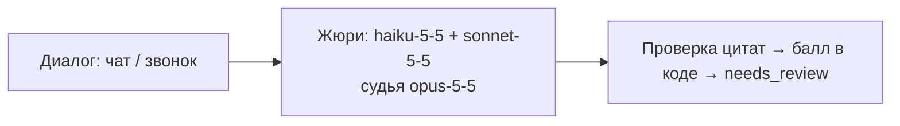
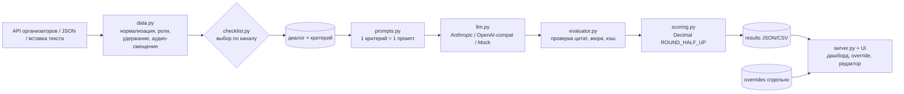
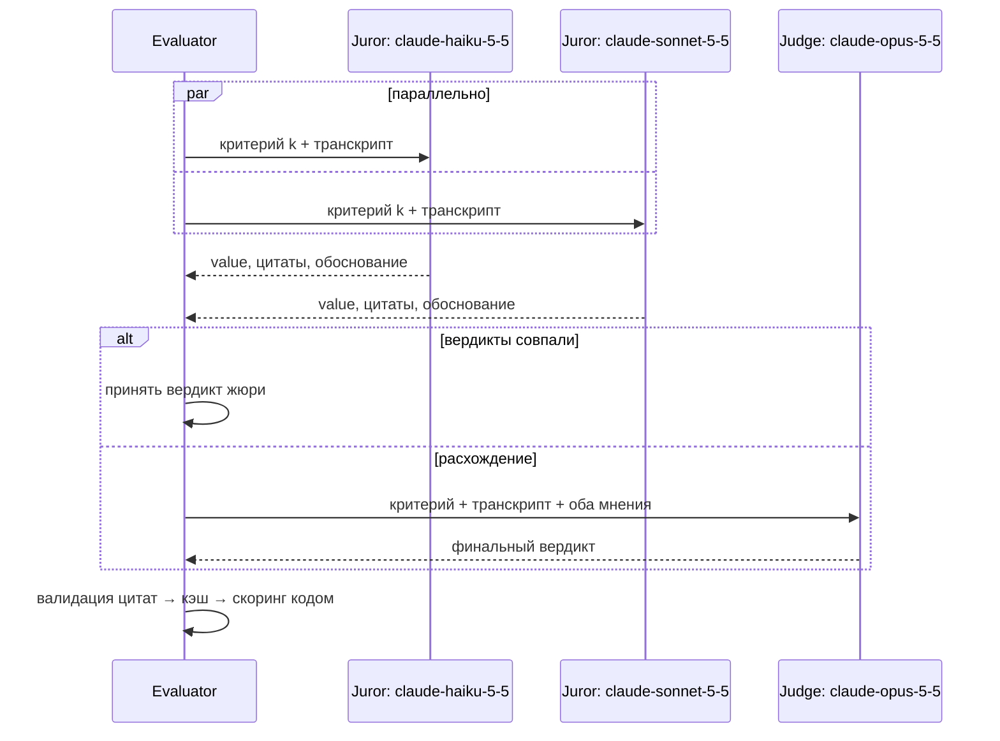

# CQA — AI-оценка качества чатов и звонков Freedom Broker

> **Жюри из LLM проверяет каждый критерий отдельно, приводит дословные цитаты-доказательства и считает балл детерминированным кодом.**
> LLM jury scores every checklist criterion separately, backs each verdict with verified verbatim quotes, and computes the score in deterministic code.

[](https://github.com/useing123/d00mathon/actions/workflows/ci.yml)


[English version ↓](#english) · [Pitch deck (PDF)](docs/CQA_Pitch_Deck.pdf) · [Presentation (HTML)](docs/presentation.html) · [Architecture](docs/ARCHITECTURE.md) · [Router](docs/ROUTER.md) · [Scoring](docs/SCORING.md) · [Assumptions](docs/ASSUMPTIONS.md) · [Evaluation](docs/EVALUATION.md) · [API](docs/API.md)

## Главное

**Основной режим — жюри Claude** (`--preset jury`, по умолчанию; им сделан `results/dev/results.json`): Haiku и Sonnet голосуют по каждому критерию, при расхождении решает Opus; каждая оценка с дословной цитатой; итог считает код.



| Метрика | Значение |
|---|---|
| Совпадение с эталоном, отложенный набор (10 синтетических диалогов) | **<span data-n="jury_heldout">0.95</span>** (95 % CI <span data-n="jury_heldout_ci">[0.875, 1.000]</span>) |
| Средний балл на DEV (65 диалогов организаторов, 0 ошибок) | **<span data-n="dev_mean">80.14</span>** |
| Стоимость, $ за диалог (DEV) | **<span data-n="jury_usd">$0.158</span>** |
| Флаги `needs_review` (DEV) | 18.3% критериев |

**Для большого потока** тот же пайплайн доступен как каскад Jev 1.14 → Haiku → Sonnet (`--preset cascade`): <span data-n="cascade_heldout">0.963</span> на отложенном наборе, <span data-n="dev_agreement">0.948</span> совпадения с жюри на DEV, <span data-n="cascade_usd">$0.0146</span> за диалог (в <span data-n="cost_ratio">11×</span> дешевле); спорные вердикты первого уровня получают дословную цитату отдельным шагом (`CQA_EVIDENCE_STEP`, +$0.001/диалог). Если данные не должны покидать контур — тот же каскад с локальной Qwen3.8-27B (vLLM) на первом уровне: <span data-n="local_cascade_heldout">0.95</span>. Какой режим рекомендуем в продакшен — [docs/PRODUCTION.md](docs/PRODUCTION.md).

| Режим | Отложенный набор | $/диалог | Критерии с проверенной цитатой (отложенный / DEV) | Спорные вердикты с цитатой |
|---|---|---|---|---|
| жюри (`--preset jury`, основной) | <span data-n="jury_heldout">0.95</span> | <span data-n="jury_usd">$0.158</span> | 0.975 / 0.756 | 0.946 / 0.649 |
| каскад (`--preset cascade`) + шаг цитат | <span data-n="cascade_heldout">0.963</span> | <span data-n="cascade_usd">$0.0146</span> + $0.001 | 0.487 / 0.654 (без шага 0.163 / 0.240) | 0.971 / 0.968 |
| локальный каскад (Qwen3.8-27B, vLLM) + шаг цитат | <span data-n="local_cascade_heldout">0.95</span> | <span data-n="local_cascade_usd">$0.00128</span> | 0.450 / — | 1.000 / — |

Цитаты: [docs/OSS_ROUTER.md](docs/OSS_ROUTER.md) (`results/oss/evidence_step.json`). Разброс жюри между 3 свежими прогонами: 7.2 % ячеек диалог×критерий меняются, σ итогового балла в среднем 2.53 ([EVALUATION](docs/EVALUATION.md)). Маскирование PII (`CQA_PII_MASK=1`): 0.956 против 0.963 без маски, в пределах шума ([PRODUCTION](docs/PRODUCTION.md)).

Все цифры — из [docs/numbers.json](docs/numbers.json) (`python scripts/pitch_numbers.py`); тест `tests/test_numbers.py` сверяет их с README, DEMO и презентацией.

> **Статус валидации**
> - ✅ **Синтетический отложенный набор**, n = 10 диалогов / 80 меток, размечен нами, по нему не настраивались: жюри <span data-n="jury_heldout">0.95</span> <span data-n="jury_heldout_ci">[0.875, 1.000]</span>, каскад <span data-n="cascade_heldout">0.963</span> <span data-n="cascade_heldout_ci">[0.912, 1.000]</span> — разница не значима, шум ±2 метки.
> - ✅ **DEV, 65 реальных диалогов**: каскад совпадает с жюри на <span data-n="dev_agreement">0.948</span> меток, грубые ошибки 5/5. Это согласие двух систем, **не точность**.
> - ⏳ **Разметка людьми — в процессе.** Набор для разметки: [docs/LABELING.md](docs/LABELING.md). До её завершения точность на реальных диалогах не измерена.

Прочие эксперименты (дообучение, Jev в одиночку, продвинутый роутер, KZ/open-weight модели, сравнение моделей) — одна страница: [docs/APPENDIX_EXPERIMENTS.md](docs/APPENDIX_EXPERIMENTS.md).
Подробно: [демо-сценарий](docs/DEMO.md) · [оценка](docs/EVALUATION.md) · [все эксперименты](EXPERIMENTS.md) · [история версий](docs/HISTORY.md).

## Submission / Сдача результатов (формат JSON 1.0)

| Файл | Что внутри | Как получить |
|---|---|---|
| [`results/dev/results.json`](results/dev/results.json) | все 65 записей DEV (60 чатов + 5 звонков), прогон `dev_jury_v8` | `make submit-dev RUN=dev_jury_v8` (без вызовов LLM) |
| `results/prod/results.json` | ровно 10 записей контрольного набора, включая ошибки | в контрольный час: `make submit GROUP=<id>` → `git push` |

- Формат — приложение к студенческому гайду «Как сдать результаты»: `{"schema_version":"1.0","team_name":"казачи капай","model":{"mode","name"},"results":[…]}`; на диалог — `status:"ok"` с 8 критериями (`contact, discovery, identification, consultation, empathy, dialogue, closure, critical`; `true/false/null` или шаг шкалы до веса) и `score:{final_score, critical_flag}`, либо `status:"error"`, `criteria:[]`, `score:null`, `error:"<причина>"` (ошибка никогда не заменяется нулём).
- `evidence_turns` — **нумерация с 1** по исходному массиву транскрипта (клиент, бот, оператор, системные события); вся система (промпт, UI, API, экспорт) использует ту же нумерацию.
- Все правила — в одном месте: [`cqa/submission.py`](cqa/submission.py); JSON-схема — [`docs/results.schema.json`](docs/results.schema.json); проверка: `python -m cqa validate results/prod/results.json` (схема, домены значений, 8 критериев по одному разу, `critical_flag == critical`, 2 знака, без дублей ID, в prod ровно 10 записей; `--group <id>` — ID совпадают с API).
- `make submit GROUP=<id>`: загрузка из API → оценка (пресет по умолчанию) → экспорт JSON 1.0 → валидация → `git add -f` + commit; push — вручную. В UI: «Ещё → Выгрузить results.json (v1.0)».
- Заменённый в UI критерий выгружается под своим `id` (или `code:` из YAML); стандартные 01–08 → официальные коды.
- **Модель и стоимость.** `results/dev/results.json`: жюри `claude-haiku-5-5` + `claude-sonnet-5-5`, судья `claude-opus-5-5` (`external_api`), $10.28 за 65 диалогов ≈ **<span data-n="jury_usd">$0.158</span> за диалог**, ≈ 5 мин. Тот же режим (`--preset jury`) — по умолчанию для новых прогонов, в т.ч. `make submit` для контрольных диалогов. Другие модели — в [приложении](docs/APPENDIX_EXPERIMENTS.md). Тихих подмен на старые модели нет: запасные модели выключены по умолчанию (`CQA_FALLBACK_MODELS`); фактическая модель записывается в `model.name`.
- **Апелляции** (два отдельных действия): «Оспорить» на карточке критерия (обязательный комментарий) → вкладка «Апелляции»: проверяющий подтверждает или меняет оценку с обязательной причиной → итог пересчитывается; карточка показывает исходную оценку, решение и итог. API: `POST /api/appeals`, `GET /api/appeals?group=&status=`, `POST /api/appeals/{id}/resolve`.
- Точность на реальных DEV-диалогах **не измерена** человеком (нет разметки); измерено только на синтетических gold-наборах (см. [docs/EVALUATION.md](docs/EVALUATION.md)).

Система оценивает работу **оператора-человека** (не бота) по гибкому чек-листу: чаты и голосовые звонки, RU / KZ / EN. Для каждого критерия — значение, обоснование, дословная цитата с номером реплики (или «где ожидалось действие»), итог 0–100 и отдельный флаг грубой ошибки. Веб-интерфейс без логина: дашборд, карточка диалога с подсветкой доказательств, аудиоплеер, ручная проверка (override), редактор чек-листов.

## Быстрый старт (3 команды)

```bash
make install                       # venv + зависимости
make demo                          # офлайн-прогон на синтетических диалогах (mock-LLM, без ключа)
make serve                         # UI: http://127.0.0.1:8090
```

С реальной моделью: `cp .env.example .env`, вписать `ANTHROPIC_API_KEY` и `CQA_API_URL`, затем `make eval-dev`.
Без make: `python3 -m venv .venv && .venv/bin/pip install -r requirements.txt && .venv/bin/python -m cqa evaluate --mock --input examples/sample_dialogs.json`.
Docker: `docker compose up --build` (секреты из `.env`, в образ не попадают).

### ⏱ Контрольный набор (час 23)

```bash
python -m cqa evaluate --group <ID> --organizer results/<id>_submission.csv   # или: make eval-group GROUP=<ID>
```
Опционально `--final` — усиленный профиль (присяжные sonnet + opus, судья перепроверяет единогласные 02/04/06, медиана 3 сэмплов на 04/06). На held-out наборе он **не** дал выигрыша (0.925 против 0.925–0.938 у профиля по умолчанию) при цене ×2–4, поэтому по умолчанию не включён; см. EVALUATION.
Загрузка `CQA_API_URL&group_id=<ID>` → авто-выбор чек-листа по каналу (чат → `freedom_chat_v1`, звонок → `freedom_call_v1`) → параллельная оценка → `results/<id>.json` + `results/<id>.csv`. В UI то же — кнопка **Fetch group & evaluate**. Каждый новый диалог реально анализируется LLM: заготовленных ответов нет, кэш ключуется хэшем диалога.

## Архитектура



### Жюри (режим по умолчанию)



## Как считается балл

`итог = 100 × Σ набранное / Σ весов применимых критериев`, где YES = вес, NO = 0, шкала = `вес × шаг / максимальный_шаг`, NA исключается из числителя **и** знаменателя. Округление `Decimal ROUND_HALF_UP` до 2 знаков. Критерий 08 «Грубые ошибки» без веса — отдельный флаг `gross_error`. Нет применимых критериев → `total = null`.

**Пример с NA** (чат-чек-лист, тест `test_readme_worked_example`):

| Критерий | Вес | Оценка | Балл |
|---|---|---|---|
| 01 Контакт | 10 | YES | 10 |
| 02 Потребность | 15 | NA | — |
| 03 Идентификация | 20 | NA | — |
| 04 Консультация | 20 | 15 из 20 | 15 |
| 05 Эмпатия | 15 | NO | 0 |
| 06 Управление/грамотность | 15 | 7 из 10 | 10.5 |
| 07 Завершение | 5 | NA | — |
| **Итого** | **60 применимо** | | **100 × 35.5 / 60 = 59.17** |

Все крайние случаи и соответствующие тесты: [docs/SCORING.md](docs/SCORING.md).

## Как максимизируется точность
- **Один критерий — один запрос.** В промпте только рубрика и правила принятия решения этого критерия.
- **Жюри + судья.** Haiku и Sonnet голосуют параллельно; при расхождении решает Opus. На DEV (v7) жюри согласилось в 85.4% из 520 вердиктов, судья решил 76.
- **Меньше шума на шкалах.** Если судья решает шкальный критерий (04, 06), он отвечает 3 раза и берётся **медиана** шага (`CQA_JUDGE_SAMPLES=3`); бинарные — большинство (судья разбивает ничью 1:1). Каждый диалог получает поле `stability` (согласие голосов, диапазон итога по фактическим голосам).
- **Флаг «на проверку».** `needs_review` + причины на каждом критерии, где присяжные разошлись, решал судья или шкальное значение с низкой уверенностью; счётчик в интерфейсе (во внутреннем JSON, не в выгрузке v1.0).
- **Строгий JSON** через tool use: одна стабильная схема инструмента для всех критериев (общий кэш промпта); допустимые значения перечислены в блоке критерия и проверяются в коде (`checklist.strict_value`) — недопустимое значение → повтор с подсказкой; NA только там, где разрешён.
- **Факты, вычисленные кодом** (первая реплика оператора, эвристика языка клиента, самая долгая пауза после первого ответа и было ли предупреждение, удержания, как закончился диалог) передаются модели, чтобы она не считала время и роли сама.
- **Проверка цитат.** Цитата обязана быть дословной подстрокой указанной реплики (нормализация пробелов/кавычек/ё, фрагменты через «…»); неверный номер реплики исправляется, выдуманная цитата → повтор запроса, затем отбрасывается (`rejected_quotes`).
- **Роли и удержание.** Бот/система исключены; реплики во время консультации агентов помечены `[ВНУТРЕННИЕ ПЕРЕГОВОРЫ НА УДЕРЖАНИИ]`; ошибки ASR не наказываются.
- **Детерминированный скоринг** в коде, а не в LLM.
- **Кэш по критерию**: ключ = хэш(текст критерия + допущения + версия промпта) × модель × хэш диалога. Правка рубрики → переоценивается только этот критерий; правка веса → пересчёт без LLM.

## Интерфейс
- Дашборд: средний балл, гистограмма, распределение по критериям, флаги грубых ошибок, сортировка.
- Карточка диалога: подсветка реплик-доказательств, клик по цитате → прокрутка; NA с причиной; «ожидалось в реплике N»; ⚖ — разногласие жюри.
- Звонки: плеер `audio_url`, клик по реплике → перемотка.
- Ручная проверка: значение + обоснование + ревьюер; хранится отдельно, AI-вывод не меняется; итог «человек» и diff AI→Human; экспорт JSON / CSV AI / Human / оба.
- Загрузка JSON-файла, вставка диалога текстом, прогресс-бар оценки.
- Статусы надёжности: бейдж «неполная» (оценка критерия упала → итог не выставлен, показан предварительный), ⚠ предупреждения (неизвестные роли, доказательства не из реплик оператора), «требует проверки» для грубой ошибки без цитаты оператора; для 04 — список запросов клиента со статусами ✓/◐/✗.
- Недопустимая ручная оценка (например, 4.5 или NA там, где NA не разрешён) отклоняется сервером (HTTP 400).
- Проверка в браузере: `python scripts/ui_smoke.py http://127.0.0.1:8090 DEV` (Playwright, headless) — таблица, карточка диалога, жюри, бейдж «неполная», отказ 400 на неверную правку, 0 ошибок консоли.

## Гибкие чек-листы
Вкладка «Чек-листы» в UI или YAML в `checklists/`. Добавить критерий:
```yaml
  - id: "09"
    name: Предложение продукта
    type: binary            # или type: scale + scale: [0, 5, 10]
    weight: 5
    allow_na: true
    rubric: |
      YES — оператор уместно предложил релевантный продукт ...
    rules: |
      - ...
```
Сохранить → «Re-evaluate with current checklist» (к LLM уйдёт только новый критерий) или «Пересчитать веса» (без LLM). Валидация: уникальные id, тип, шкала (`tests/test_checklist.py`).

## Своя модель (прототип)
Дообученный адаптер Qwen3-8B и инструкция запуска на своей GPU: [docs/FINETUNE.md](docs/FINETUNE.md) (итог — в [приложении](docs/APPENDIX_EXPERIMENTS.md)).

## Локальная LLM (Ollama / vLLM)
```bash
CQA_PROVIDER=openai CQA_OPENAI_BASE_URL=http://127.0.0.1:11434/v1 CQA_MODEL=qwen2.5:14b \
  python -m cqa evaluate --input examples/sample_dialogs.json
```
Те же промпты, JSON-режим, та же схема и валидация цитат. `CQA_PROVIDER=mock` (или `--mock`) — детерминированная эвристика без сети для тестов, CI и демо (не для точности).

## Допущения

| # | Допущение | Где задано |
|---|---|---|
| 1 | Критерий 01: «первая реплика» = первая реплика **человека-оператора**; приветствие бота не засчитывается | `assumptions.first_reply` |
| 2 | Критерий 07: прощание + (итог ИЛИ предложение помощи), буквально по чек-листу | рубрика 07 |
| 3 | Время первого ответа, теги, вложения не оцениваются; «явное ожидание» позже — > 3 мин (180 с), задаётся только в YAML (`assumptions.long_wait_seconds`) | docs/ASSUMPTIONS.md |
| 4 | Звонки (по замечанию организаторов): критерий 06 оценивает логику, ясность, отсутствие неуместных выражений, корректность речи и управление паузами; в 04 и всех остальных ошибки ASR не наказываются | `freedom_call_v1.yaml` |
| 5 | Реплики во время удержания — внутренние, не оцениваются | `ignore_internal_hold_turns` |
| 6 | Аудио-смещение = время реплики − время первой реплики (приближение) | `cqa/data.py` |
| 7 | Округление ROUND_HALF_UP до 2 знаков | `assumptions.rounding` |

Подробно (включая таблицу сверки каждого правила с текстом официального чек-листа): [docs/ASSUMPTIONS.md](docs/ASSUMPTIONS.md#rubric-alignment-official-checklist-pdf-vs-our-yaml).

## Выбор модели (пресеты)
`python -m cqa evaluate --preset jury|cascade|econom|balanced|max` (или `CQA_PRESET=...`). По умолчанию `jury`; сравнение моделей — [docs/APPENDIX_EXPERIMENTS.md](docs/APPENDIX_EXPERIMENTS.md), матрица — [docs/MODELS.md](docs/MODELS.md) (страница `/models`).

## Результаты
См. [«Главное»](#главное). Распределения значений до/после выравнивания рубрики,
шум и флаги проверки — [docs/EVALUATION.md](docs/EVALUATION.md); прежние версии — [docs/HISTORY.md](docs/HISTORY.md).

## Ограничения (честно)
- Для DEV нет размеченного ground truth; gold-набор синтетический и размечен нами — это регрессионная проверка, а не оценка точности на скрытой разметке.
- Если оценка критерия упала (ошибка API), диалог помечается `incomplete` и итог не выставляется (fail-closed).
- Наиболее неоднозначные критерии — 07, 04, 05 (субъективность рубрики).
- Облачный режим жюри стоит денег (<span data-n="jury_usd">$0.158</span> на диалог); локальные модели измерены только на синтетическом held-out (см. [приложение](docs/APPENDIX_EXPERIMENTS.md)).
- Смещение аудио приблизительное: запись может стартовать не синхронно с транскриптом.
- Фоновые задачи UI живут в памяти процесса; авторизации нет (по условию).
- Mock-провайдер — эвристика для тестов, не бейзлайн качества.

## Структура проекта
```
cqa/
  config.py      .env + переменные окружения
  data.py        загрузка/fetch, нормализация, удержание, аудио-смещения
  checklist.py   YAML-чек-листы, валидация, хэш критерия, выбор по каналу
  prompts.py     системный промпт + промпт на каждый критерий + JSON-схема
  llm.py         Anthropic | OpenAI-совместимый | MockBackend
  evaluator.py   жюри/судья, проверка цитат, кэш, пул потоков
  scoring.py     детерминированный скоринг
  store.py       результаты, overrides, CSV
  server.py      FastAPI; static/index.html — UI
  __main__.py    CLI: evaluate / stats / rescore / serve
checklists/      freedom_chat_v1.yaml, freedom_call_v1.yaml
examples/        sample_dialogs.json — 4 синтетических диалога (RU/EN/KZ чат + RU звонок)
tests/           pytest (offline, mock): скоринг, цитаты, чек-листы, кэш-ключ, fail-closed, строгие значения, роли/время, факты, жюри, провайдеры, безопасность путей, gold, mock e2e, HTTP API
docs/            ARCHITECTURE, SCORING, ASSUMPTIONS, EVALUATION, API, презентация + PDF
EXPERIMENTS.md   все эксперименты: CI, парные тесты, лидерборд, Pareto, абляции (scripts/build_experiments.py)
Makefile · pyproject.toml · Dockerfile · docker-compose.yml · .github/workflows/ci.yml
```

## CLI
`python -m cqa evaluate [--group G | --input file.json] [--ids a,b] [--limit N] [--checklist ID] [--fresh] [--mock] [--confirm 03,04] [--final] [--organizer out.csv] [--concurrency N] [--refresh]` · `python -m cqa stats --group G` · `python -m cqa rescore --group G` · `python -m cqa serve --port 8090` · `python -m cqa gold [--dir D | --labels F]` · `python -m cqa label` · `python -m cqa export --group G --format organizer`.

## Публичный репозиторий
`.env`, `data/` (сырые диалоги), `results/` (цитаты клиентов), `.cache/` — в `.gitignore`. Данные загружаются во время работы через `CQA_API_URL`. В `examples/` только выдуманные диалоги.

---

<a id="english"></a>
## English

**CQA** evaluates the *human operator* in Freedom Broker chats and voice calls (RU/KZ/EN) against a flexible YAML checklist. Each criterion is a separate LLM call; a jury (claude-haiku-5-5 + claude-sonnet-5-5) votes in parallel and claude-opus-5-5 adjudicates disagreements. Every verdict carries a justification and verbatim, turn-referenced quotes validated against the transcript. The 0–100 score is computed in code (NA weight redistribution, Decimal ROUND_HALF_UP); gross errors are a separate flag.

**Quickstart:** `make install && make demo && make serve` (offline, mock LLM). Real run: fill `.env` from `.env.example`, then `python -m cqa evaluate --group <ID>` → `results/<id>.json|csv`.

**Highlights:** per-criterion prompts · LLM jury + judge · quote validation with auto-correction / retry · deterministic scoring · per-criterion cache (editing one rubric re-evaluates only that criterion; reweighting needs no LLM) · no-login web UI with evidence highlighting, audio seek, human override (stored separately, AI vs Human diff, CSV/JSON export) and checklist editor · cloud (Anthropic), local (Ollama/vLLM via OpenAI-compatible API) or offline mock · Docker · CI on 3.11/3.12 without secrets.

**Results (main mode = jury):** held-out synthetic set (n=10) **<span data-n="jury_heldout">0.95</span>** <span data-n="jury_heldout_ci">[0.875, 1.000]</span>; DEV: 65 dialogs, 0 errors, mean **<span data-n="dev_mean">80.14</span>**, **<span data-n="jury_usd">$0.158</span> per dialog**. High-volume option: cascade (`--preset cascade`) <span data-n="cascade_heldout">0.963</span> held-out, <span data-n="cascade_usd">$0.0146</span> per dialog. Human labels on real dialogs: in progress ([docs/LABELING.md](docs/LABELING.md)). Other experiments: [docs/APPENDIX_EXPERIMENTS.md](docs/APPENDIX_EXPERIMENTS.md).

**Limitations:** no labelled ground truth for real DEV dialogs; both gold sets are synthetic and self-labelled; criteria 04/05/06 are the most subjective; audio offsets are approximate; local models measured only on the synthetic held-out set.

**Robustness:** fail-closed `incomplete` status after a rescue pass over other models, strict values, operator-quote checks, untrusted-transcript boundary, code-computed facts (waits, holds, language, ending), path-safe ids, atomic writes.

UI: [docs/UI.md](docs/UI.md).

Docs: [Architecture](docs/ARCHITECTURE.md) · [Scoring](docs/SCORING.md) · [Assumptions](docs/ASSUMPTIONS.md) · [Evaluation](docs/EVALUATION.md) · [API](docs/API.md) · [Deck](docs/CQA_Pitch_Deck.pdf). License: [MIT](LICENSE).
