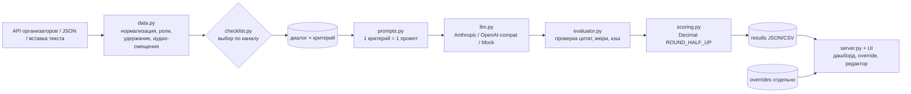
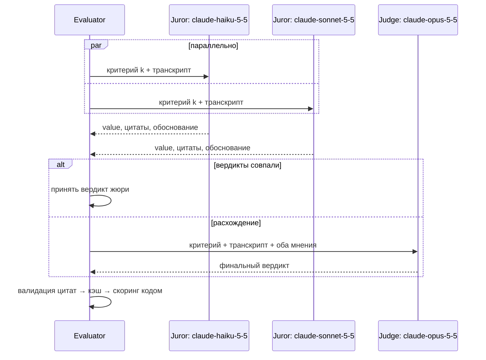

# CQA — AI-оценка качества чатов и звонков Freedom Broker

> **Жюри из LLM проверяет каждый критерий отдельно, приводит дословные цитаты-доказательства и считает балл детерминированным кодом.**
> LLM jury scores every checklist criterion separately, backs each verdict with verified verbatim quotes, and computes the score in deterministic code.


[English version ↓](#english) · [Pitch deck (PDF)](docs/CQA_Pitch_Deck.pdf) · [Presentation (HTML)](docs/presentation.html) · [Architecture](docs/ARCHITECTURE.md) · [Scoring](docs/SCORING.md) · [Assumptions](docs/ASSUMPTIONS.md) · [Evaluation](docs/EVALUATION.md) · [API](docs/API.md)

Система оценивает работу **оператора-человека** (не бота) по гибкому чек-листу: чаты и голосовые звонки, RU / KZ / EN. Для каждого критерия — значение, обоснование, дословная цитата с номером реплики (или «где ожидалось действие»), итог 0–100 и отдельный флаг грубой ошибки. Веб-интерфейс без логина: дашборд, карточка диалога с подсветкой доказательств, аудиоплеер, ручная проверка (override), редактор чек-листов.

## Быстрый старт (3 команды)

```bash
make install                       # venv + зависимости
make demo                          # офлайн-прогон на синтетических диалогах (mock-LLM, без ключа)
make serve                         # UI: http://127.0.0.1:8090
```

С реальной моделью: `cp .env.example .env`, вписать `ANTHROPIC_API_KEY` и `CQA_API_URL`, затем `make eval-dev`.
Без make: `python3 -m venv .venv && .venv/bin/pip install -r requirements.txt && .venv/bin/python -m cqa evaluate --mock --input examples/sample_dialogs.json`.
Docker: `docker compose up --build` (секреты из `.env`, в образ не попадают).

### ⏱ Контрольный набор (час 23)

```bash
python -m cqa evaluate --group <ID>        # или: make eval-group GROUP=<ID>
```
Загрузка `CQA_API_URL&group_id=<ID>` → авто-выбор чек-листа по каналу (чат → `freedom_chat_v1`, звонок → `freedom_call_v1`) → параллельная оценка → `results/<id>.json` + `results/<id>.csv`. В UI то же — кнопка **Fetch group & evaluate**. Каждый новый диалог реально анализируется LLM: заготовленных ответов нет, кэш ключуется хэшем диалога.

## Архитектура



### Жюри (режим по умолчанию)



## Как считается балл

`итог = 100 × Σ набранное / Σ весов применимых критериев`, где YES = вес, NO = 0, шкала = `вес × шаг / максимальный_шаг`, NA исключается из числителя **и** знаменателя. Округление `Decimal ROUND_HALF_UP` до 2 знаков. Критерий 08 «Грубые ошибки» без веса — отдельный флаг `gross_error`. Нет применимых критериев → `total = null`.

**Пример с NA** (чат-чек-лист, тест `test_readme_worked_example`):

| Критерий | Вес | Оценка | Балл |
|---|---|---|---|
| 01 Контакт | 10 | YES | 10 |
| 02 Потребность | 15 | NA | — |
| 03 Идентификация | 20 | NA | — |
| 04 Консультация | 20 | 15 из 20 | 15 |
| 05 Эмпатия | 15 | NO | 0 |
| 06 Управление/грамотность | 15 | 7 из 10 | 10.5 |
| 07 Завершение | 5 | NA | — |
| **Итого** | **60 применимо** | | **100 × 35.5 / 60 = 59.17** |

Все крайние случаи и соответствующие тесты: [docs/SCORING.md](docs/SCORING.md).

## Как максимизируется точность
- **Один критерий — один запрос.** В промпте только рубрика и правила принятия решения этого критерия.
- **Жюри + судья.** Haiku и Sonnet голосуют параллельно; при расхождении решает Opus. На DEV жюри согласилось в 84.4% из 520 вердиктов, судья решил 81.
- **Строгий JSON** через tool use: одна стабильная схема инструмента для всех критериев (общий кэш промпта); допустимые значения перечислены в блоке критерия и проверяются в коде (`checklist.strict_value`) — недопустимое значение → повтор с подсказкой; NA только там, где разрешён.
- **Факты, вычисленные кодом** (первая реплика оператора, эвристика языка клиента, самая долгая пауза после первого ответа и было ли предупреждение, удержания, как закончился диалог) передаются модели, чтобы она не считала время и роли сама.
- **Проверка цитат.** Цитата обязана быть дословной подстрокой указанной реплики (нормализация пробелов/кавычек/ё, фрагменты через «…»); неверный номер реплики исправляется, выдуманная цитата → повтор запроса, затем отбрасывается (`rejected_quotes`).
- **Роли и удержание.** Бот/система исключены; реплики во время консультации агентов помечены `[ВНУТРЕННИЕ ПЕРЕГОВОРЫ НА УДЕРЖАНИИ]`; ошибки ASR не наказываются.
- **Детерминированный скоринг** в коде, а не в LLM.
- **Кэш по критерию**: ключ = хэш(текст критерия + допущения + версия промпта) × модель × хэш диалога. Правка рубрики → переоценивается только этот критерий; правка веса → пересчёт без LLM.

## Интерфейс
- Дашборд: средний балл, гистограмма, распределение по критериям, флаги грубых ошибок, сортировка.
- Карточка диалога: подсветка реплик-доказательств, клик по цитате → прокрутка; NA с причиной; «ожидалось в реплике N»; ⚖ — разногласие жюри.
- Звонки: плеер `audio_url`, клик по реплике → перемотка.
- Ручная проверка: значение + обоснование + ревьюер; хранится отдельно, AI-вывод не меняется; итог «человек» и diff AI→Human; экспорт JSON / CSV AI / Human / оба.
- Загрузка JSON-файла, вставка диалога текстом, прогресс-бар оценки.
- Статусы надёжности: бейдж «неполная» (оценка критерия упала → итог не выставлен, показан предварительный), ⚠ предупреждения (неизвестные роли, доказательства не из реплик оператора), «требует проверки» для грубой ошибки без цитаты оператора; для 04 — список запросов клиента со статусами ✓/◐/✗.
- Недопустимая ручная оценка (например, 4.5 или NA там, где NA не разрешён) отклоняется сервером (HTTP 400).
- Проверка в браузере: `python scripts/ui_smoke.py http://127.0.0.1:8090 DEV` (Playwright, headless) — таблица, карточка диалога, жюри, бейдж «неполная», отказ 400 на неверную правку, 0 ошибок консоли.

## Гибкие чек-листы
Вкладка «Чек-листы» в UI или YAML в `checklists/`. Добавить критерий:
```yaml
  - id: "09"
    name: Предложение продукта
    type: binary            # или type: scale + scale: [0, 5, 10]
    weight: 5
    allow_na: true
    rubric: |
      YES — оператор уместно предложил релевантный продукт ...
    rules: |
      - ...
```
Сохранить → «Re-evaluate with current checklist» (к LLM уйдёт только новый критерий) или «Пересчитать веса» (без LLM). Валидация: уникальные id, тип, шкала (`tests/test_checklist.py`).

## Локальная LLM (Ollama / vLLM)
```bash
CQA_PROVIDER=openai CQA_OPENAI_BASE_URL=http://127.0.0.1:11434/v1 CQA_MODEL=qwen2.5:14b \
  python -m cqa evaluate --input examples/sample_dialogs.json
```
Те же промпты, JSON-режим, та же схема и валидация цитат. `CQA_PROVIDER=mock` (или `--mock`) — детерминированная эвристика без сети для тестов, CI и демо (не для точности).

## Допущения

| # | Допущение | Где задано |
|---|---|---|
| 1 | Критерий 01: «первая реплика» = первая реплика **человека-оператора**; приветствие бота не засчитывается | `assumptions.first_reply` |
| 2 | Критерий 07 оценивается строго | рубрика 07 |
| 3 | Время первого ответа, теги, вложения не оцениваются | docs/ASSUMPTIONS.md |
| 4 | Звонки (по замечанию организаторов): критерий 06 оценивает логику, ясность и управление паузами вместо грамотности письма; в 04 и всех остальных ошибки ASR не наказываются | `freedom_call_v1.yaml` |
| 5 | Реплики во время удержания — внутренние, не оцениваются | `ignore_internal_hold_turns` |
| 6 | Аудио-смещение = время реплики − время первой реплики (приближение) | `cqa/data.py` |
| 7 | Округление ROUND_HALF_UP до 2 знаков | `assumptions.rounding` |

Подробно: [docs/ASSUMPTIONS.md](docs/ASSUMPTIONS.md).

## Результаты на DEV
**Gold-набор (16 размеченных синтетических диалогов, `python -m cqa gold`):** точное совпадение 0.969–0.984 в двух одинаковых прогонах текущей версии (шум ±2 вердикта из 128), MAE итога 0.9–1.7, грубые ошибки precision/recall 1.0/1.0 — см. [docs/EVALUATION.md](docs/EVALUATION.md) (это проверка регрессий, а не оценка совпадения со скрытой разметкой).
**DEV v3** (после правок по ревью): 65 диалогов, 0 ошибок, 0 неполных, средний балл 78.08, 5 флагов грубых ошибок (те же диалоги), $13.03 / 275 с.

65 диалогов (60 чатов: RU 30 / KZ 15 / EN 15; 5 звонков RU), 0 ошибок, средний балл 75.95, 5 флагов грубых ошибок. Полный прогон ≈ 5 мин и ≈ $13; 10 диалогов ≈ 1 мин и ≈ $2. Методика: [docs/EVALUATION.md](docs/EVALUATION.md).

## Ограничения (честно)
- Для DEV нет размеченного ground truth; gold-набор синтетический и размечен нами — это регрессионная проверка, а не оценка точности на скрытой разметке.
- Если оценка критерия упала (ошибка API), диалог помечается `incomplete` и итог не выставляется (fail-closed).
- Наиболее неоднозначные критерии — 07, 04, 05 (субъективность рубрики).
- Облачный режим жюри стоит денег (≈ $0.2 на диалог); точность локальной модели мы не измеряли.
- Смещение аудио приблизительное: запись может стартовать не синхронно с транскриптом.
- Фоновые задачи UI живут в памяти процесса; авторизации нет (по условию).
- Mock-провайдер — эвристика для тестов, не бейзлайн качества.

## Структура проекта
```
cqa/
  config.py      .env + переменные окружения
  data.py        загрузка/fetch, нормализация, удержание, аудио-смещения
  checklist.py   YAML-чек-листы, валидация, хэш критерия, выбор по каналу
  prompts.py     системный промпт + промпт на каждый критерий + JSON-схема
  llm.py         Anthropic | OpenAI-совместимый | MockBackend
  evaluator.py   жюри/судья, проверка цитат, кэш, пул потоков
  scoring.py     детерминированный скоринг
  store.py       результаты, overrides, CSV
  server.py      FastAPI; static/index.html — UI
  __main__.py    CLI: evaluate / stats / rescore / serve
checklists/      freedom_chat_v1.yaml, freedom_call_v1.yaml
examples/        sample_dialogs.json — 4 синтетических диалога (RU/EN/KZ чат + RU звонок)
tests/           100 тестов: скоринг, цитаты, чек-листы, кэш-ключ, fail-closed, строгие значения, роли/время, факты, жюри, провайдеры, безопасность путей, gold, mock e2e, HTTP API
docs/            ARCHITECTURE, SCORING, ASSUMPTIONS, EVALUATION, API, презентация + PDF
Makefile · pyproject.toml · Dockerfile · docker-compose.yml · .github/workflows/ci.yml
```

## CLI
`python -m cqa evaluate [--group G | --input file.json] [--ids a,b] [--limit N] [--checklist ID] [--fresh] [--reeval] [--mock] [--concurrency N] [--refresh]` · `python -m cqa stats --group G` · `python -m cqa rescore --group G` · `python -m cqa serve --port 8090`.

## Публичный репозиторий
`.env`, `data/` (сырые диалоги), `results/` (цитаты клиентов), `.cache/` — в `.gitignore`. Данные загружаются во время работы через `CQA_API_URL`. В `examples/` только выдуманные диалоги.

---

<a id="english"></a>
## English

**CQA** evaluates the *human operator* in Freedom Broker chats and voice calls (RU/KZ/EN) against a flexible YAML checklist. Each criterion is a separate LLM call; a jury (claude-haiku-5-5 + claude-sonnet-5-5) votes in parallel and claude-opus-5-5 adjudicates disagreements. Every verdict carries a justification and verbatim, turn-referenced quotes validated against the transcript. The 0–100 score is computed in code (NA weight redistribution, Decimal ROUND_HALF_UP); gross errors are a separate flag.

**Quickstart:** `make install && make demo && make serve` (offline, mock LLM). Real run: fill `.env` from `.env.example`, then `python -m cqa evaluate --group <ID>` → `results/<id>.json|csv`.

**Highlights:** per-criterion prompts · LLM jury + judge · quote validation with auto-correction / retry · deterministic scoring · per-criterion cache (editing one rubric re-evaluates only that criterion; reweighting needs no LLM) · no-login web UI with evidence highlighting, audio seek, human override (stored separately, AI vs Human diff, CSV/JSON export) and checklist editor · cloud (Anthropic), local (Ollama/vLLM via OpenAI-compatible API) or offline mock · Docker · CI on 3.11/3.12 without secrets.

**DEV results (v1):** 65 dialogs (60 chats, 5 calls), 0 errors, mean 75.95, 5 gross-error flags; jurors agreed on 84.4% of 520 criterion verdicts, the judge decided 81. Full run ~5 min / ~$13.

**Limitations:** no labelled ground truth for DEV (accuracy checked by manual review of a sample); criteria 07/04/05 are the most subjective; audio offsets are approximate; local-model accuracy not measured.

**Gold set:** 16 hand-labelled synthetic dialogs, `python -m cqa gold` → exact agreement 0.969–0.984 across two identical runs of the current version (±2/128 run-to-run noise), total MAE 0.9–1.7, gross-flag P/R 1.0/1.0. **Robustness:** fail-closed `incomplete` status, strict values, operator-quote checks, untrusted-transcript boundary, path-safe ids, atomic writes. Review history: [docs/REVIEW_QUORUM.md](docs/REVIEW_QUORUM.md).

Docs: [Architecture](docs/ARCHITECTURE.md) · [Scoring](docs/SCORING.md) · [Assumptions](docs/ASSUMPTIONS.md) · [Evaluation](docs/EVALUATION.md) · [API](docs/API.md) · [Deck](docs/CQA_Pitch_Deck.pdf). License: [MIT](LICENSE).
