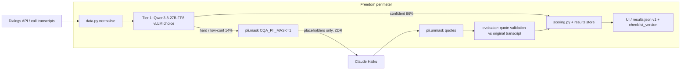

# Production mode for Freedom: one recommendation

**Recommendation:** run the **local cascade inside the Freedom perimeter**.
- **Tier 1:** self-hosted Qwen3.8-27B-FP8 on vLLM in decision ("choice") mode.
- **Tier 2:** escalate only the uncertain or hard criteria (04/05/06, low confidence, 08=YES) to Claude Haiku. Escalated text goes out only with `CQA_PII_MASK=1`, under a zero-data-retention agreement.
- **Fallback:** if the security team does not approve any external call, set escalation to off. That is the fully on-prem mode, measured at 0.938.

Why this mode:
- **Accuracy.** Held-out 0.950 (80 labels), escalation 13.8 %. That matches the Claude jury (0.950) and is within noise of the best configurations (EXPERIMENTS §3.1: no significant pairwise difference).
- **Cost.** $0.00128/dialog, about 58× cheaper than the jury ($0.0745).
- **Data.** 86 % of decisions never leave the perimeter, and the 14 % that do are masked.
- Sources: `results/kz_models/cascade-vllm-choice__Qwen_Qwen3.8-27B-FP8.json`, `vllm-choice__…json`, EXPERIMENTS.md.

**Caveat:** choice mode returns decisions without verbatim quotes. Quotes come only from escalated (Haiku) criteria, so the evidence UI is thinner in this mode. If quotes are required for every criterion, the alternative is mode C below (Qwen generate, 0.963) at about 23× the GPU cost.

## Modes, cost and latency (measured per dialog → scaled)

Assumptions:
- Per-dialog cost and time are taken from held-out runs (10 dialogs).
- GPU cost = rented A40 $0.59/h (H100 $3.99/h) × measured s/dialog at the run's concurrency (4–8).
- Cloud cost = Anthropic list prices (cqa/pricing.py).
- Cost scales linearly. Owned GPUs are a fixed cost instead.

| mode | held-out | $/dialog | s/dialog | $/day 1k | 5k | 20k | GPU-h/day 1k / 5k / 20k |
|---|---|---|---|---|---|---|---|
| **A. Local cascade Qwen27B-choice → Haiku (masked)** | 0.950 | 0.00128 | 7.65 | 1.3 | 6.4 | 26 | 2.1 / 10.6 / 42.5 (A40) |
| B. Fully on-prem, Qwen27B-choice only | 0.938 | 0.0012 | 7.3 | 1.2 | 6.0 | 24 | 2.0 / 10.1 / 40.6 (A40) |
| C. Qwen27B generate with quotes | 0.963 | 0.0294 | 26.6 | 29 | 147 | 588 | 7.4 / 37 / 148 (H100) |
| D. Claude jury haiku+sonnet→opus | 0.950 | 0.0745 (DEV 0.16) | 4.5 | 75 | 373 | 1490 | — |
| E. Cloud cascade Jev→Haiku→Sonnet | 0.963 | 0.00423 | 1.3 | 4.2 | 21 | 85 | — |

**GPU sizing for A/B:** one A40 handles about 490 dialogs/h, or about 11.8k/day at 100 % load.
- 1k/day: 1× A40 (or any 48 GB GPU). Run a second one only for HA.
- 5k/day: 1× A40 at about 45 % load; recommend 2 for HA and peaks.
- 20k/day: 2× A40 running 24/7 at about 90 % load; recommend 3–4 if the work must finish in a business-hours window.
- An H100 is not needed for choice mode. The H100 throughput was never measured: the pod did not come up (docs/KZ_MODELS.md).

## Data flow

The placeholder→value map lives only in process memory (`cqa/pii.py` `REGISTRY`) and never leaves the perimeter.

## PII masking (`cqa/pii.py`)

**What it masks.** It is deterministic: one placeholder per distinct value, `⟨KIND_sha6⟩`, salted with `CQA_PII_SALT`. Masking is lossless and reversible. Entity types:
- IIN/ЖСН (12 digits with checksum check)
- KZ IBAN
- card numbers (Luhn check)
- e-mail addresses
- +7/8 phone numbers
- account/contract numbers that follow a keyword (RU/KZ/EN)
- dates of birth (years 1920–2019)
- names after «меня зовут / менің атым / my name is», plus a `CQA_PII_NAMES` list

**Where it runs.** The hook is in `LLM.call`: the outgoing prompt is masked and the returned tool arguments are unmasked. Quotes are therefore validated against the original transcript and shown with the original values.

**Measured on held-out.** Sonnet single, masking on, compared with the cached runs without masking:

| run | agreement | MAE | $/dialog | s/dialog |
|---|---|---|---|---|
| unmasked r1 / r2 (cached) | 0.950 / 0.975 | 3.11 / — | 0.0783 / 0.0804 | 4.62 / 4.34 |
| masked r1 / r2 | 0.963 / 0.950 | 4.00 / 4.77 | — (cost not captured) / 0.0870 | — / 4.37 |

- **Agreement:** no measurable change. Masked 0.956 vs unmasked 0.963 on average; both inside the ±2-label noise floor. Each masked run differs from each unmasked run by 5/80 labels.
- **Quotes:** 0 rejected quotes, 0 placeholders leaked into evidence.
- **Criterion 01** ("introduced by name") stayed at 1.0 even though operator names were masked: the model treated the placeholder as a name.
- **Cost:** about +9 % on r2. That run made 11.8 vs about 11.1 calls/dialog, likely run variance or concurrent prompt edits rather than masking itself; the token overhead of placeholders is negligible.
- **Limitation:** held-out is synthetic and contains only names (8 entities), so this does **not** test IIN/phone/card masking on real data. Those types are covered only by unit tests (`tests/test_pii.py`).
- **Not done:** jury and cascade runs with masking on were not run (time).

## Universality and versioning

- `checklists/generic_sales_v1.yaml`: a 5-criterion sales script with weights, an NA rule, 0–2 scales and custom codes. It loads and validates.
  - Mock run: 3 DEV dialogs scored (`results/generic/mock_dev3.json`).
  - Real jury: 2 DEV dialogs scored, $0.19 (`results/generic/jury_dev2.json`, totals 27.27 / 15.0). These are support dialogs, so the low sales scores are expected.
  - v1 export: `results/generic/jury_dev2.v1.json`. It validates with `submission.validate(..., custom_checklist=True)`; only warnings remain, about non-official codes.
- Every dialog result now stores `checklist_id` + `checklist_version` (`<version>+<12-hex hash of criterion hashes>`). Run meta already stores per-criterion hashes.
