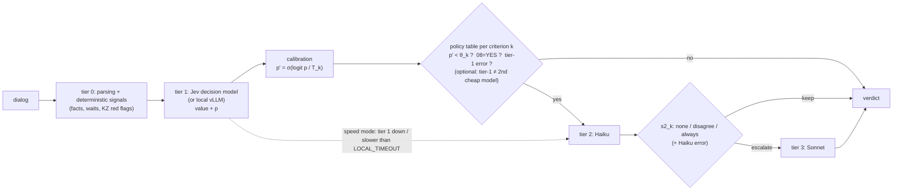
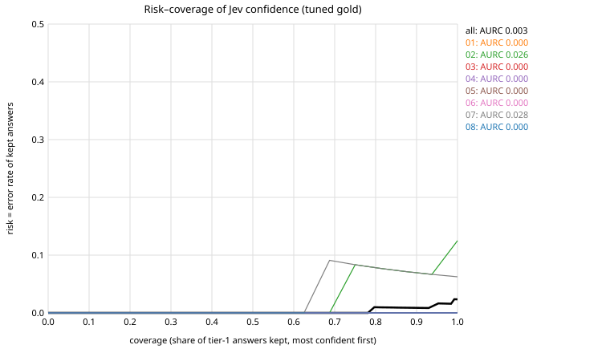
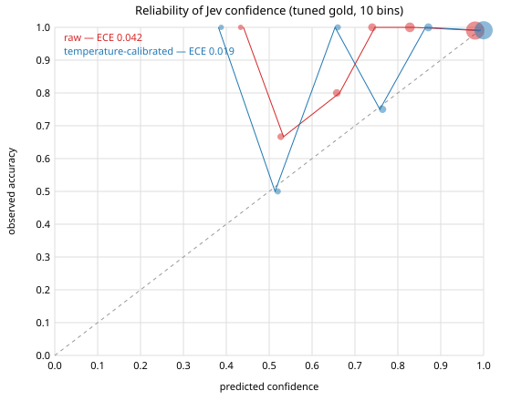
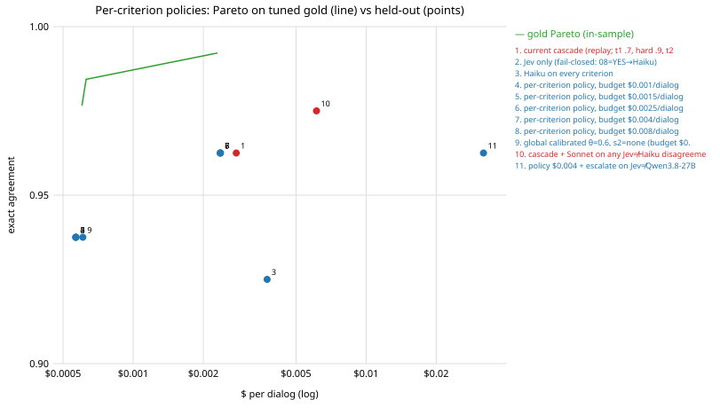

# Advanced router: calibrated confidence → per-criterion cost-aware policy

This builds on the cascade in [OSS_ROUTER.md](OSS_ROUTER.md) (`cqa/router.py`, preset `cascade`). It adds a measurable
layer: how good the tier-1 confidence actually is (risk–coverage, calibration), a **per-criterion policy table**
fitted under a $/dialog budget, and disagreement-based escalation. All of it was produced **offline**: cached tier
outputs replayed, with no new API calls and no GPU.

```
python scripts/router_policy.py          # fit on tuned gold → results/router_policy/*, docs/img/*.svg
CQA_ROUTER_POLICY=results/router_policy/policy_0.0025.json  python -m cqa ...   # use a policy live
```

Code: `cqa/routing_policy.py` (pure logic + live hook), `scripts/router_policy.py` (study), tests in
`tests/test_routing_policy.py`. The rows also show up in EXPERIMENTS.md as `router policy: …` (family
"router policy (offline replay)").

## Architecture



* **Fail-closed rules, never tuned away:** a tier-1 error or invalid value goes to Haiku, 08 (gross error) = YES
  goes to Haiku, a Haiku error goes to Sonnet, and if every tier fails the router raises instead of guessing.
  Speed mode is unchanged. The hook only replaces `tier1_reasons` / `tier2_reasons`.
* **Live hook:** if `CQA_ROUTER_POLICY` is set, `cqa/router.py` calls `routing_policy.patch()`, which swaps the
  global T1 / HARD_CONF / T2 thresholds for the per-criterion `{theta, s2}` table plus the calibration stored in the
  JSON. If the variable is unset, nothing changes.

## Data (what is cached, and what is not)

| set | tier 1 (Jev) | Haiku | Sonnet | Qwen3.8-27B |
|---|---|---|---|---|
| tuned gold, 16 dialogs / 128 labels (fitting only) | all (`results/oss/jev_all_gold.json`) | all (same `--all-escalate` run) | all | **none** |
| held-out, 10 dialogs / 80 labels (evaluation only) | all (`results/jev/holdout.dialogs.json`, the run the cascade used) | 55 / 80 from `.cache/router` (exact cascade prompt), 25 from `results/bench/haiku__holdout` | 3 / 80 from cache, 77 from `results/bench/sonnet__holdout` | all (`results/kz_models/q38_27b_fp8_holdout.json`) |

Some Haiku and Sonnet answers on held-out are *proxies*: they come from the single-model benchmark run, which uses
the same prompts and checklist but is a different call. Each policy row records how many proxy answers it actually
used (`bench_proxy_answers_used` in `study.json`): 0 for the cascade replay, 2 for the $0.0025 policy, 4 for
disagreement routing. The Qwen agreement rule could not be tuned, because no gold run is cached for Qwen. It is a
fixed rule, evaluated once.

Prices come from the cached runs: Jev costs $0.000527/dialog; Haiku costs $0.000404/call and Sonnet $0.00839/call
(`cloud_usd_by_model` ÷ 128 calls in `jev_all_gold.json`); Qwen on the GPU costs $0.0294/dialog. The cascade
replayed with these average prices costs **$0.00277/dialog**. That is lower than the $0.00423 in EXPERIMENTS.md,
which counts the actual tokens of that run. Compare policies only against the replay figure.

## 1. Selective prediction: risk–coverage of Jev's confidence



| | all | 01 | 02 | 03 | 04 | 05 | 06 | 07 | 08 |
|---|---|---|---|---|---|---|---|---|---|
| tier-1 accuracy (gold) | 0.977 | 1.00 | 0.875 | 1.00 | 1.00 | 1.00 | 1.00 | 0.938 | 1.00 |
| AURC gold | **0.0026** | 0 | 0.0265 | 0 | 0 | 0 | 0 | 0.0282 | 0 |
| AURC oracle (perfect ranking) | 0.0004 | 0 | 0.012 | 0 | 0 | 0 | 0 | 0.0039 | 0 |
| AURC held-out | **0.0076** | 0 | 0.044 | 0.010 | 0.091 | 0 | 0 | 0 | 0 |

Jev gets only 3 of 128 gold labels wrong (2 on 02, 1 on 07). Its confidence ranks those errors reasonably well:
AURC is 0.0026, against 0.0004 for a perfect ranking and ≈0.023 (the error rate) for a random one. On held-out,
the errors move to 04 (scale), where the gold set has **no** tier-1 errors to learn from at all.

## 2. Calibration (fitted on tuned gold only)

Per-criterion temperature scaling on logit(p), with the per-criterion T shrunk towards the global T. Sixteen labels
per criterion are too few for isotonic regression per criterion, so global isotonic (PAV) is shown only as a
reference.



| ECE (10 bins) | raw | temperature (global T = 0.61, T_k 0.50–0.73) | global isotonic |
|---|---|---|---|
| tuned gold (in-sample) | 0.042 | 0.019 | 0.004 (overfit) |
| held-out | **0.040** | **0.025** | 0.035 |

T < 1 means Jev is *under*-confident in its 0.7–0.95 range: most of those answers are right. A temperature map is
monotone, so calibration does not change the risk–coverage ranking. What it adds is that one threshold carries the
same meaning across criteria, and that p' can be read as a probability in the policy JSON and in the UI.

## 3. Cost-aware per-criterion policies

For each criterion k the options are θ_k ∈ {0, .5, .6, .7, .8, .85, .9, .95, .98, 1.01} on the calibrated p' and
s2_k ∈ {none, disagree, always}, which gives 30 options per criterion. Because cost and accuracy add up over
criteria, the **exact** Pareto frontier is a multiple-choice knapsack with dominance pruning
(`pareto_policies`). Each budget picks the most accurate point on that frontier that fits
(`results/router_policy/policy_<budget>.json`).



The gold frontier has only three points, because the gold set saturates:

| gold $/dialog | gold acc | policy |
|---|---|---|
| 0.00060 | 0.977 | Jev only (+ fail-closed) |
| 0.00063 | 0.984 | 02: θ 0.8 → Haiku |
| 0.00230 | 0.992 | 02: θ 0.8 → Haiku → Sonnet if Haiku ≠ Jev; all other criteria θ = 0 |

The current cascade reaches the same 0.992 on gold at $0.00268 (replay prices), so on gold the $0.0023 policy saves only ≈14 %. Budgets of $0.0025, $0.004 and
$0.008 all select the same table. With a single global (θ, s2) the frontier ends at θ = 0.98 + disagree, which
reaches 0.992 at $0.0044.

## 4/5. Held-out: every policy evaluated once

Columns: bootstrap 95 % CI over dialogs (10 000 reps, `build_experiments.boot_ci`); paired Δ against the cascade
replay (`build_experiments.paired`). Tier shares are tier 1 / 2 / 3.

| policy | gold | held-out [95 % CI] | Δ vs cascade [95 % CI] | $/dialog | tiers 1/2/3 % |
|---|---|---|---|---|---|
| **current cascade** (replay; t1 .7, hard .9, t2 .7) | 0.992 | **0.963** [0.912, 1.000] | — | 0.00277 | 82 / 15 / 2 |
| Jev only (fail-closed) = policy $0.001 = $0.0015 | 0.977 / 0.984 | 0.938 [0.900, 0.975] | −0.025 [−0.075, +0.025] | 0.00057 | 99 / 1 / 0 |
| global calibrated θ 0.6, s2 none | 0.984 | 0.938 [0.900, 0.975] | −0.025 [−0.075, +0.025] | 0.00061 | 98 / 2 / 0 |
| Haiku on every criterion | 0.977 | 0.925 [0.863, 0.975] | −0.037 [−0.100, +0.000] | 0.00376 | 0 / 100 / 0 |
| **per-criterion policy, $0.0025** (= $0.004 = $0.008) | 0.992 | **0.963** [0.925, 1.000] | +0.000 [−0.037, +0.037] | **0.00237** | 95 / 2 / 2 |
| policy $0.004 + escalate on Jev ≠ Qwen3.8-27B (untuned) | 0.992 | 0.963 [0.925, 1.000] | +0.000 [−0.037, +0.037] | 0.0319 (GPU) | 91 / 6 / 2 |
| **cascade + Sonnet on any Jev ≠ Haiku disagreement** | 0.992 | **0.975** [0.938, 1.000] | +0.013 [+0.000, +0.037], p_boot 0.70 | 0.00612 | 82 / 10 / 8 |
| reference: Claude jury (EXPERIMENTS.md) | — | 0.950 [0.875, 1.000] | | 0.0745 | |

Reading the table:

* **Nothing significantly beats the cascade.** With 80 labels on 10 dialogs, a single label moves accuracy by 0.0125.
* The **per-criterion $0.0025 policy** matches the cascade (0.963) at about 14 % lower cost under the same price
  model, and keeps 95 % of answers at tier 1 instead of 82 %. It is fitted on only 3 gold errors, though, and it
  sets θ = 0 everywhere except 02, which removes the cascade's low-confidence and hard-criteria (04/05/06) rules.
  Against the cascade it has 1 win and 1 loss. The win is hold-10/06: the cascade's hard rule sent a correct
  Jev answer to Haiku, which got it wrong. The loss is hold-06/03: the cascade escalated a low-confidence Jev
  answer to Sonnet, which fixed it. Treat it as "the same accuracy at lower cost on this data", not as a better
  router.
* **Disagreement-based escalation**, meaning Sonnet whenever Haiku disagrees with Jev regardless of Haiku's
  confidence, is the only variant above the cascade: 0.975, +1 label, at 2.2× the cost. The CI of Δ touches 0
  and McNemar shows 1 win and 0 losses (hold-10/06, where Sonnet overrules Haiku's wrong answer), so this is not
  significant. Four of its Sonnet answers are benchmark
  proxies. It is the cheapest candidate to confirm on DEV/new gold.
* **Confidence-only vs agreement on tier 1:** adding Qwen3.8-27B as a second cheap opinion (escalate when the two
  disagree) adds 3 Haiku calls and no accuracy, and the GPU makes it about 13× more expensive. Not worth it here.
* Calibration improves held-out ECE (0.040 → 0.025) but gives no accuracy gain. That is expected: it only changes
  what a threshold means, not the ranking.

## Limitations

* The gold set is tiny and saturated (3 tier-1 errors). Per-criterion thresholds are barely identified, and the
  frontier collapses to three policies. The principled machinery (calibration, exact knapsack frontier, budgets)
  is ready for a bigger labelled set; the numbers above are not.
* Held-out uses benchmark-run proxies for 25 Haiku and 77 Sonnet answers (only 0–4 are used per policy). $ figures
  use average per-call prices, not token-exact costs.
* The Qwen rule is untuned (no gold run). Tier-1 latency and speed mode were not replayed.
* Recommendation: keep the current cascade as the default. Ship `policy_0.0025.json` as an opt-in low-cost mode,
  but only together with a global low-confidence floor (θ ≥ 0.7 on every criterion), which keeps the cascade's
  fail-safe and would have kept hold-06/03. Re-fit once more labels exist.
